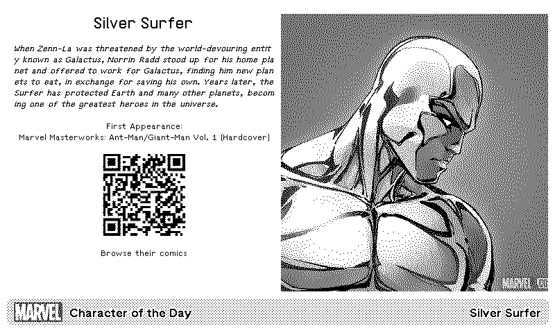

# Marvel Character of the Day
  

## Laraina

Laraina was Queen of Martian Zoranthus (whatever that is) until deposed by her enemy Golak. She escaped and started recruiting an army of rebels to reclaim her throne. Her activities remained largely secret to escape Golak's watchful eye. She kept an eye for the activities of handsome racer Comet Pierce and fell in love with him from afar. At some point Pierce crash-landed on an isolated asteroid and left for dead. Laraina rushed to rescue him and slew the erpentine Horror" with her heat gun. She nursed Pierce back to health and then confronted him with a kiss, a confession of love and a present: a rocket engine able to travel at high speeds.

**First Appearance:** Red Raven Comics #1 (8/1/1940)

[Character Details](https://comicvine.gamespot.com/laraina/4005-78678/)

<h2>What is this repository?</h2>
Marvel Character of the Day is a PowerShell-based application hosted in GitHub that provides information about a different Marvel character each day. The repository picks a random character daily @ 5am UTC.

<h3>Features</h3>

- <b>Daily Marvel Character Information:</b> Fetches and displays information about a random Marvel character every day from ComicVine's API.

- <b>Automated Scripts:</b> Uses PowerShell scripts and GitHub Workflow Actions to automate the process of retrieving and displaying character data.
  
- <b>Friendly JSON Endpoint:</b> Offers an easily retrievable endpoint containing a JSON file with the Daily Character information. You can find this here: https://raw.githubusercontent.com/MarkHopper24/Marvel-Character-of-the-Day/refs/heads/main/MarvelCharacterOfTheDay.json
  
- <b>TRMNL Integration:</b> Offers markdown templates for usage with [TRMNL](https://usetrmnl.com). To use this data for a plugin, you can either:
    1. Create a custom plugin with the polling strategy pointing to the JSON endpoint above. Copy the contents of the files in the .\templates folder to your plugin's markdown, and you're done.
    2. One-click install as a [Plugin recipe](https://help.usetrmnl.com/en/articles/10122094-plugin-recipes).

 
(Sample TRMNL screenshot)

<h3>Attribution</h3>
Data provided by Comic Vine https://comicvine.gamespot.com. © 2025 Marvel
This project and repository has no affilliation with Marvel.

