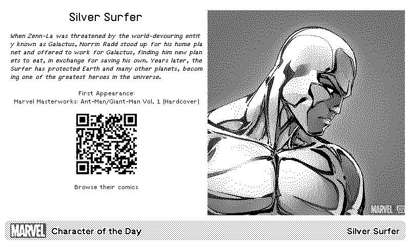

# Marvel Character of the Day
  

## White Tiger

Originally a white tigress, High Evolutionary needed someone able to track down and kill Man-Beast, so he created White Tiger and gifted her with immunity to mental attacks of Man-Beast. White Tiger was created by Roger Stern and Pascual Ferry for use in Marvel Comics. White Tiger's first appearance is in Heroes for Hire #1 which was released in July of 1997.

**First Appearance:** Heroes for Hire #1 (7/31/1997)

[Character Details](https://comicvine.gamespot.com/white-tiger/4005-64450/)

<h2>What is this repository?</h2>
Marvel Character of the Day is a PowerShell-based application hosted in GitHub that provides information about a different Marvel character each day. The repository picks a random character daily @ 5am UTC.

<h3>Features</h3>

- <b>Daily Marvel Character Information:</b> Fetches and displays information about a random Marvel character every day from ComicVine's API.

- <b>Automated Scripts:</b> Uses PowerShell scripts and GitHub Workflow Actions to automate the process of retrieving and displaying character data.
  
- <b>Friendly JSON Endpoint:</b> Offers an easily retrievable endpoint containing a JSON file with the Daily Character information. You can find this here: https://raw.githubusercontent.com/MarkHopper24/Marvel-Character-of-the-Day/refs/heads/main/MarvelCharacterOfTheDay.json
  
- <b>TRMNL Integration:</b> Offers markdown templates for usage with [TRMNL](https://usetrmnl.com). To use this data for a plugin, you can either:
    1. Create a custom plugin with the polling strategy pointing to the JSON endpoint above. Copy the contents of the files in the .\templates folder to your plugin's markdown, and you're done.
    2. One-click install as a [Plugin recipe](https://help.usetrmnl.com/en/articles/10122094-plugin-recipes).

 
(Sample TRMNL screenshot)

<h3>Attribution</h3>
Data provided by Comic Vine https://comicvine.gamespot.com. © 2025 Marvel
This project and repository has no affilliation with Marvel.

